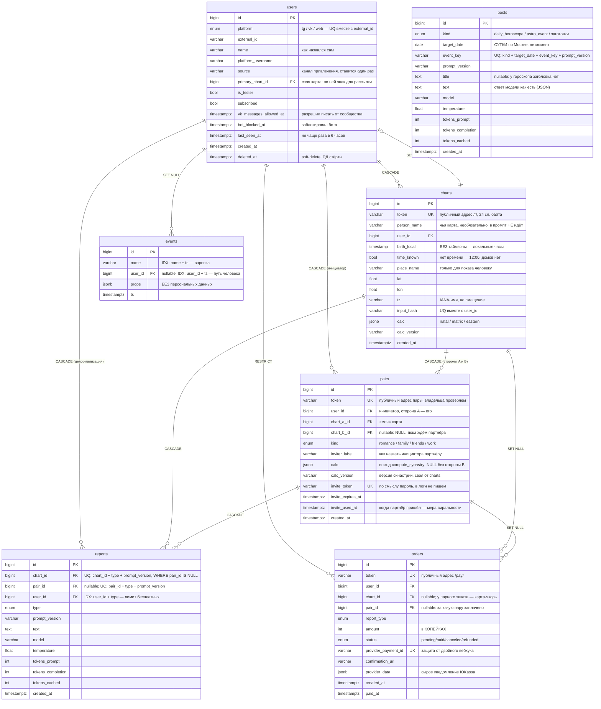

# Схема базы данных

Карта связей между таблицами из [`backend/app/models/`](../backend/app/models/)
(файл на таблицу; снаружи импортируется как один пакет).
Единственный источник правды — сами модули моделей; этот документ объясняет
**почему** связи устроены именно так, и должен обновляться вместе с ними.

## Диаграмма



`posts` в диаграмме стоит особняком: связей у неё нет ни с кем — пост
сообщества не принадлежит ни человеку, ни карте.

## Связи по одной

| Откуда → куда | Кардинальность | ondelete | Зачем именно так |
|---|---|---|---|
| `charts.user_id` → `users.id` | 1 : N | **CASCADE** | Персональные данные (дата и место рождения) живут только здесь — «удалить мои данные» = снести charts |
| `reports.chart_id` → `charts.id` | 1 : N | **CASCADE** | Текст разбора без карты бессмыслен |
| `reports.user_id` → `users.id` | 1 : N | **CASCADE** | Денормализация ради `COUNT(user_id, type)` — проверка лимита бесплатных без джойна с charts |
| `orders.user_id` → `users.id` | 1 : N | **RESTRICT** | Заказ переживает пользователя: историю платежей стирать нельзя |
| `orders.chart_id` → `charts.id` | 1 : N, nullable | **SET NULL** | Карту человек вправе удалить, заказ — нет. Компромисс: заказ остаётся, но без ссылки на данные рождения |
| `pairs.user_id` → `users.id` | 1 : N | **CASCADE** | Пара принадлежит инициатору; в её `calc` производные от данных рождения обоих |
| `pairs.chart_a_id` → `charts.id` | 1 : N | **CASCADE** | Сторона «я». Удалили карту — пары с ней хранить нельзя, это те же персональные данные |
| `pairs.chart_b_id` → `charts.id` | 1 : N, nullable | **CASCADE** | Сторона «партнёр». NULL, пока не пришёл по инвайту; карта в любом случае принадлежит инициатору |
| `reports.pair_id` → `pairs.id` | 1 : N, nullable | **CASCADE** | Текст парного разбора без пары бессмыслен и содержит данные обоих |
| `orders.pair_id` → `pairs.id` | 1 : N, nullable | **SET NULL** | Та же развилка, что у `orders.chart_id`: пару удалить можно, денежный факт — нет |
| `events.user_id` → `users.id` | 1 : N, nullable | **SET NULL** | Событие обезличивается, но вчерашняя воронка не меняется задним числом. Relationship в ORM намеренно нет: событий тысячи, нужны они агрегатами |
| `users.primary_chart_id` → `charts.id` | 1 : 1, nullable | **SET NULL** | Какая из карт — собственная карта человека: по её знаку Солнца идёт рассылка. Удаление карты гасит признак, но не уносит пользователя. Единственный ключ, направленный от `users` наружу, — отсюда цикл в схеме |

## Как это работает в жизни — поток данных

```
1. Первое касание
   бот / Mini App ──► users (platform + external_id)      ──► events "start"

2. Ввод даты рождения
   geo.py + natal.py ──► charts (input_hash, calc JSONB)   ──► events "birth_entered"
   ▲ повтор с теми же данными → UQ (user_id, input_hash) вернёт ту же строку

3. Бесплатный разбор
   COUNT reports WHERE (user_id, type = free_natal) < лимит?
        └─ ищем reports по (chart_id, type, prompt_version)
             ├─ нашли  → отдаём текст, DeepSeek не трогаем
             └─ нет    → LLM ──► reports (+ токены, модель, temperature)

4. Пейволл
   orders (PENDING, token, amount) ──► ссылка site/pay/<token> ──► ЮKassa
                                                                     │
5. Вебхук ЮKassa ──► поиск по provider_payment_id ──► status = PAID, paid_at
                                                                     │
6. Разблокировка ──► reports (full_natal) по order.chart_id + order.report_type
```

Ветка совместимости пристраивается сбоку, шагами 2 и 3 переиспользуя те же
таблицы:

```
2'. Сборка пары
    своя карта + карта партнёра ──► pairs (chart_a_id, chart_b_id, kind)
    ▲ партнёра либо вводит инициатор сам (это обычная строка charts в его
      аккаунте), либо тот приходит по invite_token — тогда chart_b_id
      заполняется одним UPDATE ... WHERE chart_b_id IS NULL

3'. Тизер и платный разбор
    ищем reports по (pair_id, type, prompt_version) — chart_id при этом
    заполнен картой инициатора, но в адресе кеша не участвует
```

## Уникальность и индексы

| Таблица | Ограничение / индекс | Что защищает или ускоряет |
|---|---|---|
| `users` | UQ `(platform, external_id)` | 12345 в Telegram и 12345 во ВКонтакте — разные люди |
| `charts` | UQ `(user_id, input_hash)` | «Посчитай ещё раз» не плодит дубли карт (а с ними — лишние походы в LLM) |
| `charts` | UQ `token` | Ссылка `/r/<token>` на разбор: по соседнему id читалась бы чужая дата и место рождения |
| `reports` | UQ `(chart_id, type, prompt_version)` **WHERE pair_id IS NULL** | Адрес кеша обычного разбора: один текст на карту + продукт + версию промпта |
| `reports` | UQ `(pair_id, type, prompt_version)` **WHERE pair_id IS NOT NULL** | То же для совместимости, где адрес — пара, а не карта. Почему двумя частичными, а не одним общим — ниже, в «Местах, где схема неочевидна» |
| `reports` | IDX `(user_id, type)` | `COUNT` перед каждым разбором — иначе полный проход по таблице |
| `orders` | UQ `token` | Публичная ссылка, которую нельзя подобрать перебором соседнего id |
| `orders` | UQ `provider_payment_id` | ЮKassa повторяет вебхук, пока не получит 200 — защита от двойного зачисления |
| `orders` | IDX `(user_id, status)` | «Мои покупки» и «кто из них платил» |
| `orders` | UQ `(user_id, chart_id, report_type)` **WHERE status='pending' AND pair_id IS NULL** | Ждущий оплаты заказ на товар только один: два одновременных нажатия «купить» иначе заводят два заказа и два платежа в ЮKassa. Частичный намеренно — оплаченных и отменённых на ту же тройку бывает сколько угодно, это история покупок |
| `orders` | UQ `(user_id, pair_id, report_type)` **WHERE status='pending' AND pair_id IS NOT NULL** | То же для пар. Без разделения по `pair_id` два ожидающих заказа на разные пары с общей картой-якорем упирались бы друг в друга, и это выглядело бы как молчащая кнопка «купить» |
| `pairs` | UQ `token`, UQ `invite_token` | Публичный адрес пары и приглашение; второй по смыслу пароль, подбор перебором исключён 24 случайными байтами |
| `pairs` | UQ `(user_id, chart_a_id, chart_b_id, kind)` **WHERE chart_b_id IS NOT NULL** | Дедуп собранной пары. Частичный — незавершённых инвайтов на одну карту законно бывает несколько (позвали двоих). `kind` в ключе, потому что он идёт в промпт: без него смена «романтика» → «работа» молча вернула бы прежний текст из кеша |
| `pairs` | IDX `(user_id)` | Список «мои пары» на экране совместимости |
| `events` | IDX `(name, ts)` | Воронка: сколько раз случилось событие X за неделю |
| `events` | IDX `(user_id, ts)` | Путь одного человека — для поддержки и разбора отвала |
| `posts` | UQ `(kind, target_date, event_key, prompt_version)` | Адрес кеша: повторный прогон генератора не платит DeepSeek за уже написанный текст. Своего индекса под чтение недели нет намеренно — при двухмесячном хранении в таблице порядка сотни строк |

Внешний ключ в Postgres индекс сам по себе **не** создаёт — те индексы, что нужны, заведены явно.

## Места, где схема неочевидна

**`reports` висит на двух родителях сразу** (`chart_id` и `user_id`). Это не ошибка
нормализации, а осознанный дубль: владельца видно и через `charts`, но самый частый
запрос сервиса — «сколько бесплатных разборов этого типа человек уже получил» — должен
быть одним `COUNT` по индексу `(user_id, type)`, а не джойном на каждое сообщение боту.

**`pairs` — это «расчёт», как `charts`, а не «второй chart_id у отчёта».** Соблазн
был обойтись колонкой `reports.partner_chart_id`, и он ломается о Postgres: два
`NULL` в UNIQUE не равны, поэтому ключ `(chart_id, partner_chart_id, type, version)`
снял бы защиту от дублей **со всех существующих натальных отчётов** — а на ней
держится главное правило «за один текст платим один раз». Отсюда два частичных
индекса вместо одного общего. Расчёту пары вдобавок негде было бы жить:
`charts.calc` дедуплицируется по данным одного человека, `reports` хранит текст.

Отдельная таблица `pair_reports` отвергнута по другой причине: это второй кеш,
второй замок от двойной генерации, второй счётчик дневного потолка и второй
`sections()`. Через полгода одна копия получила бы починку, а вторая нет; вдобавок
`count_generated_last_day()` считает строки `reports` — потолок расходов молча
перестал бы видеть половину трат.

**`reports.chart_id` у парного отчёта остаётся NOT NULL и хранит карту
инициатора.** Это якорь, а не адрес кеша: на нём держатся денормализованный
`user_id`, каскадное удаление и дневной потолок трат. Адрес же — `pair_id`.
Прямое следствие: `has_paid`, не различающий пары, отдал бы купившему «я + Маша»
разбор «я + Лена» бесплатно — карта-якорь та же, тип тот же.

**`pairs.chart_b_id` nullable, а не отдельная таблица `invites`.** Пара без второй
стороны — то же самое, что заказ в статусе `pending`. Приход партнёра тогда
становится одним `UPDATE ... WHERE chart_b_id IS NULL`, и гонка «открыл ссылку в
двух вкладках» закрывается базой, а не кодом. Стороны не нормализуются и не
сортируются: A — «я», B — «партнёр», текст асимметричен («его Сатурн на её Луне»
и наоборот — разные сюжеты), склейка сделала бы стороны неразличимыми.

**`pairs.inviter_label` — не копия `charts.person_name`.** Имя карты человек вводил
про себя и для себя; показать его третьему лицу на анонимном экране приглашения —
утечка персональных данных. Поэтому отдельное поле «как тебя назвать партнёру»,
которое человек заполняет, зная, что его увидят.

**`orders.report_type` и `reports.type` — один и тот же enum `ReportType`**, но связи
между строками нет. Стыковка логическая: после оплаты сервис ищет (или генерирует)
отчёт с этим типом для `order.chart_id` — или для `order.pair_id`, если заказ
парный. Отсюда же грабли: CHECK на этот enum физически существует в **двух**
таблицах, и забытая `orders` молчит до первой продажи пары, то есть до момента
с деньгами в руках (миграция `d7a5c31fb904` правит оба). Работает, пока один
заказ = один отчёт;
под комплект за 890 ₽ понадобится отдельная таблица позиций заказа — денежные данные
должны оставаться проверяемыми внешними ключами, а не свободным JSON.

**Оценка тестера живёт в `events`, а не в своей таблице** — и джойнится по
`props->>'report_id'`. Ключ именно отчёт, а не пара (карта, тип): оценивают
конкретную редакцию текста, и после бампа `VERSION` старые звёзды не должны
переезжать на новый разбор. Отсюда следствие для админки: события `feedback`,
записанные до появления `report_id` в `props`, в сводку оценок не попадают —
восстанавливать их по (chart_id, type) значит приписывать оценку тексту,
которого человек не видел. Отдельной таблицы нет намеренно: `props` JSONB
избавляет от миграции на каждое новое поле анкеты, а оценок за всю обкатку —
сотни, не миллионы. Персональных данных в `props` по-прежнему нет.

**`users.vk_messages_allowed_at` — единственная копия данных, которых больше
нигде нет.** VK не отдаёт через API список разрешивших писать сообществу
(проверено 2026-08-20, см.
[astro-context.md](astro-context.md), «Контур сообщества VK»): не записали в
момент нажатия — потеряли
навсегда. Поэтому колонка, а не вычисление на лету, и поэтому же откат
миграции `19a9fbdcd7a4` невосстановим. Время, а не флаг, — первая дата
показывает конверсию экрана подписки, ради которой Mini App теперь и
существует. `NULL` значит «не разрешал или отозвал».

Отписка живёт в соседней колонке `subscribed`, и это разделение обязательное:
кнопка «не присылать» гасит её, а `vk_messages_allowed_at` не трогает вовсе —
иначе каждое нажатие уничтожало бы невосстановимую запись. Стереть разрешение
имеют право только настоящие отзывы: событие `message_deny` и ошибка 901 при
отправке. Рассылка проверяет обе колонки сразу
([astro-context.md](astro-context.md), «Контур сообщества VK»).

**`users.primary_chart_id` замыкает цикл `users → charts → users`, и цена
этого — обязательный `foreign_keys` в связях ORM.** Схема цикл переносит
спокойно (колонка nullable), а SQLAlchemy — нет: после второго ключа между
теми же таблицами она перестаёт понимать, по какому строить `User.charts` и
`Chart.user`, и падает `AmbiguousForeignKeysError` на первом же запросе к
пользователю. Лечится указанием `foreign_keys` в обеих связях (проверено
2026-08-25, миграция `b125c0bdeff7`). По той же причине у самой колонки
`relationship` нет вовсе: он потребовал бы `post_update`, то есть лишнего
UPDATE при создании каждой карты, а объект карты в этом месте не нужен —
знак Солнца достаётся запросом из `calc`.

**`posts` не связана ни с кем, и это не упущение.** Пост сообщества ничей:
`reports` под него не подходит именно потому, что там `chart_id` и `user_id`
объявлены NOT NULL. Отсюда же отсутствие каскадов — удалять вместе с
пользователем нечего.

**Событие входит в адрес поста наравне с датой.** Первая версия ключа была
`(kind, target_date, prompt_version)`, и она молча запрещала два поста-события
в сутки — то есть устройство базы решало за редактуру, сколько выходит
постов. А дни с двумя разными поводами реальны: 30.06.2026 это и полнолуние,
и вход Юпитера в знак, причём второе бывает раз в год, а первое двенадцать.
`event_key` («solar_eclipse», «ingress:Jupiter», «aspect:Jupiter:Saturn:square»)
собирает `services/content.py`; участники обязательны там, где событий вида
бывает несколько в сутки — Меркурий и Венера входят в знак в один день
регулярно. Ключи проверены на всём 2026 годе: совпадений внутри суток нет.

**`posts.event_key` — пустая строка, а не `NULL`.** У гороскопа дня события
нет, и `NULL` напрашивается сам собой, но в уникальном индексе Postgres два
`NULL` считаются разными значениями: второй гороскоп на ту же дату записался
бы рядом с первым, обойдя защиту от повторной оплаты. Ловушка тихая — ошибка
всплыла бы счётом от DeepSeek, а не падением.

**`posts.target_date` — `date`, а не `timestamptz`**, второе (после
`charts.birth_local`) исключение из правила «все времена в UTC». Пост
адресован суткам по Москве («гороскоп на 23 августа»), а не моменту; хранить
момент значило бы пересчитывать зону при каждом чтении и однажды сдвинуть
пост на сутки — типовая ошибка чужих астропабликов.

**Чего в `posts` нет:** статуса (`draft`/`approved`/`published`) и `vk_post_id`
из первоначального плана. Публикация ручная, через отложку VK — `wall.post`
групповым ключом не вызывается (проверено 2026-08-20), — и факт публикации
это действие человека в окне браузера, заполнять такие колонки нечем.
Появятся вместе с правом `wall`, если его выдадут.

**RESTRICT на `orders` фактически блокирует `DELETE FROM users`.** То есть каскад
`users → charts` сработает только у неплатившего. У платившего сценарий «удалить мои
данные» — это не удаление строки, а:

1. `users.deleted_at = now()`, `name = NULL`;
2. отдельный `DELETE FROM charts WHERE user_id = ...` — уносит все персональные данные
   и каскадом `reports` и `pairs` (а с парами — и парные отчёты). Пары сносятся даже
   тогда, когда удалена всего одна из двух карт: в `pairs.calc` лежат производные от
   даты и места рождения обоих;
3. в заказы этого человека прилетает `chart_id = NULL` и `pair_id = NULL` (SET NULL) —
   сами заказы целы.

Строка `users` остаётся ещё и потому, что регистрации у нас нет: вернувшийся человек
придёт с той же парой `(platform, external_id)` и упёрся бы в конфликт уникальности.
Вернулся — снимаем `deleted_at`.

## Про ORM-связи

У всех relationship стоит `lazy="raise_on_sql"`. Это защита от главной ловушки
async-SQLAlchemy: обычная ленивая связь при первом обращении молча уходит в базу,
а в async это запрещено и падает `MissingGreenlet` где-нибудь в шаблоне ответа.
С этим режимом доступ разрешён, только если связь загружена явно через `selectinload`,
иначе — понятная ошибка сразу.

`passive_deletes=True` означает «за каскад отвечает база, а не Python»: SQLAlchemy
не тянет дочерние строки в память, чтобы гасить их по одной.
