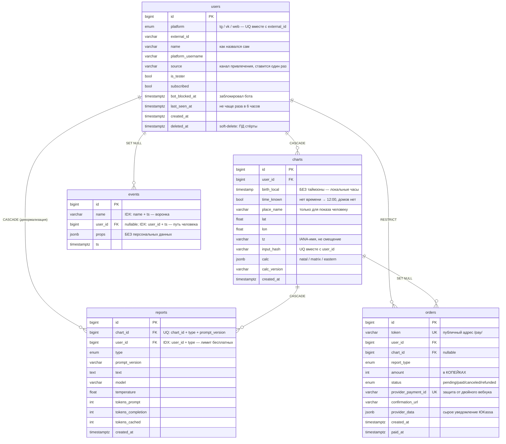

# Схема базы данных

Карта связей между таблицами из [`backend/app/models.py`](../backend/app/models.py).
Единственный источник правды — сам модуль моделей; этот документ объясняет
**почему** связи устроены именно так, и должен обновляться вместе с ним.

## Диаграмма



## Связи по одной

| Откуда → куда | Кардинальность | ondelete | Зачем именно так |
|---|---|---|---|
| `charts.user_id` → `users.id` | 1 : N | **CASCADE** | Персональные данные (дата и место рождения) живут только здесь — «удалить мои данные» = снести charts |
| `reports.chart_id` → `charts.id` | 1 : N | **CASCADE** | Текст разбора без карты бессмыслен |
| `reports.user_id` → `users.id` | 1 : N | **CASCADE** | Денормализация ради `COUNT(user_id, type)` — проверка лимита бесплатных без джойна с charts |
| `orders.user_id` → `users.id` | 1 : N | **RESTRICT** | Заказ переживает пользователя: историю платежей стирать нельзя |
| `orders.chart_id` → `charts.id` | 1 : N, nullable | **SET NULL** | Карту человек вправе удалить, заказ — нет. Компромисс: заказ остаётся, но без ссылки на данные рождения |
| `events.user_id` → `users.id` | 1 : N, nullable | **SET NULL** | Событие обезличивается, но вчерашняя воронка не меняется задним числом. Relationship в ORM намеренно нет: событий тысячи, нужны они агрегатами |

## Как это работает в жизни — поток данных

```
1. Первое касание
   бот / Mini App ──► users (platform + external_id)      ──► events "start"

2. Ввод даты рождения
   geo.py + natal.py ──► charts (input_hash, calc JSONB)   ──► events "birth_entered"
   ▲ повтор с теми же данными → UQ (user_id, input_hash) вернёт ту же строку

3. Бесплатный разбор
   COUNT reports WHERE (user_id, type = free_natal) < лимит?
        └─ ищем reports по (chart_id, type, prompt_version)
             ├─ нашли  → отдаём текст, DeepSeek не трогаем
             └─ нет    → LLM ──► reports (+ токены, модель, temperature)

4. Пейволл
   orders (PENDING, token, amount) ──► ссылка site/pay/<token> ──► ЮKassa
                                                                     │
5. Вебхук ЮKassa ──► поиск по provider_payment_id ──► status = PAID, paid_at
                                                                     │
6. Разблокировка ──► reports (full_natal) по order.chart_id + order.report_type
```

## Уникальность и индексы

| Таблица | Ограничение / индекс | Что защищает или ускоряет |
|---|---|---|
| `users` | UQ `(platform, external_id)` | 12345 в Telegram и 12345 во ВКонтакте — разные люди |
| `charts` | UQ `(user_id, input_hash)` | «Посчитай ещё раз» не плодит дубли карт (а с ними — лишние походы в LLM) |
| `reports` | UQ `(chart_id, type, prompt_version)` | Адрес кеша: один текст на карту + продукт + версию промпта |
| `reports` | IDX `(user_id, type)` | `COUNT` перед каждым разбором — иначе полный проход по таблице |
| `orders` | UQ `token` | Публичная ссылка, которую нельзя подобрать перебором соседнего id |
| `orders` | UQ `provider_payment_id` | ЮKassa повторяет вебхук, пока не получит 200 — защита от двойного зачисления |
| `orders` | IDX `(user_id, status)` | «Мои покупки» и «кто из них платил» |
| `events` | IDX `(name, ts)` | Воронка: сколько раз случилось событие X за неделю |
| `events` | IDX `(user_id, ts)` | Путь одного человека — для поддержки и разбора отвала |

Внешний ключ в Postgres индекс сам по себе **не** создаёт — те индексы, что нужны, заведены явно.

## Три места, где схема неочевидна

**`reports` висит на двух родителях сразу** (`chart_id` и `user_id`). Это не ошибка
нормализации, а осознанный дубль: владельца видно и через `charts`, но самый частый
запрос сервиса — «сколько бесплатных разборов этого типа человек уже получил» — должен
быть одним `COUNT` по индексу `(user_id, type)`, а не джойном на каждое сообщение боту.

**`orders.report_type` и `reports.type` — один и тот же enum `ReportType`**, но связи
между строками нет. Стыковка логическая: после оплаты сервис ищет (или генерирует)
отчёт с этим типом для `order.chart_id`. Работает, пока один заказ = один отчёт;
под комплект за 890 ₽ понадобится отдельная таблица позиций заказа — денежные данные
должны оставаться проверяемыми внешними ключами, а не свободным JSON.

**RESTRICT на `orders` фактически блокирует `DELETE FROM users`.** То есть каскад
`users → charts` сработает только у неплатившего. У платившего сценарий «удалить мои
данные» — это не удаление строки, а:

1. `users.deleted_at = now()`, `name = NULL`;
2. отдельный `DELETE FROM charts WHERE user_id = ...` — уносит все персональные данные
   и каскадом `reports`;
3. в заказы этого человека прилетает `chart_id = NULL` (SET NULL) — сами заказы целы.

Строка `users` остаётся ещё и потому, что регистрации у нас нет: вернувшийся человек
придёт с той же парой `(platform, external_id)` и упёрся бы в конфликт уникальности.
Вернулся — снимаем `deleted_at`.

## Про ORM-связи

У всех relationship стоит `lazy="raise_on_sql"`. Это защита от главной ловушки
async-SQLAlchemy: обычная ленивая связь при первом обращении молча уходит в базу,
а в async это запрещено и падает `MissingGreenlet` где-нибудь в шаблоне ответа.
С этим режимом доступ разрешён, только если связь загружена явно через `selectinload`,
иначе — понятная ошибка сразу.

`passive_deletes=True` означает «за каскад отвечает база, а не Python»: SQLAlchemy
не тянет дочерние строки в память, чтобы гасить их по одной.
